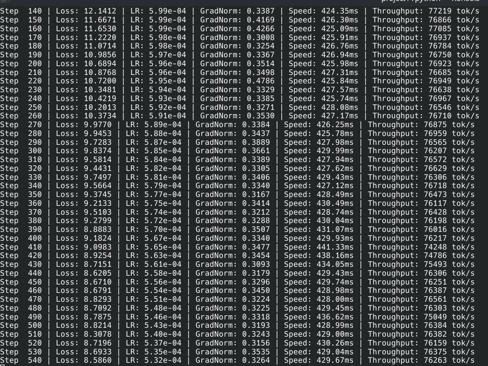
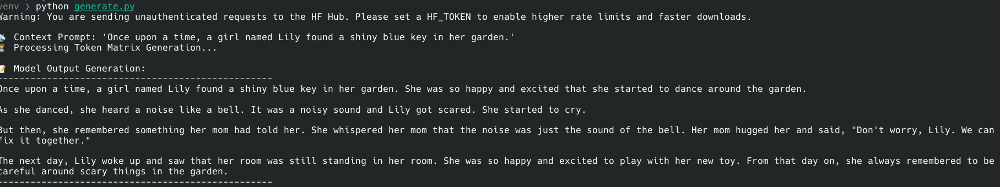

# llama-gqa-from-scratch

A LLaMA-style autoregressive transformer written from scratch in PyTorch. No `transformers`
model classes, no `nn.MultiheadAttention`, no pretrained weights: RMSNorm, SwiGLU, RoPE and
grouped-query attention are implemented directly in [`llama_gqa/model.py`](llama_gqa/model.py),
about 300 lines including the KV cache.

[](https://github.com/0xmp3/llama-gqa-from-scratch/actions/workflows/tests.yml)


Trained on TinyStories and measured on one consumer GPU: **74,600 to 80,500 tokens per second**
at **12 GB of 16 GB VRAM**.



## Measured results

From the training run whose console output and system monitor are in [`images/`](images):

| Metric | Value |
|---|---|
| Throughput | 74,604 to 80,516 tok/s, 409 to 429 ms per optimizer step |
| Tokens per step | 32,768 (batch 32 x 256 tokens x 4 accumulation steps) |
| VRAM | 12 GB of 16 GB, GPU utilisation 99%, 294 W, 60 C |
| Hardware | Ryzen 5 5600, Radeon RX 9070 XT 16 GB, ROCm on Linux |
| Precision | bf16 autocast, Flash Attention / memory-efficient SDPA |

System monitor during the run (12 GB of 16 GB, 99% GPU, 294 W): [`images/gpu-utilisation.png`](images/gpu-utilisation.png)

Re-measured on the same card under Windows 11 with AMD's ROCm 10.2 wheels, to check the code is
not Linux-specific: `train.py` holds **420 ms per step at 78,061 tok/s**, and
`benchmarks/throughput.py` reports 403 ms and 81,225 tok/s with a **7.8 GB allocator peak**. The
12 GB in the monitor above is driver-reported usage, which also counts the ROCm context and
allocator fragmentation, so the two figures measure different things rather than disagreeing.

## Architecture

| Component | Implementation |
|---|---|
| Normalisation | RMSNorm, pre-norm on both sublayers, no bias anywhere |
| Feed-forward | SwiGLU, `w2(silu(w1 x) * w3 x)`, hidden width 2048 (8/3 d rounded to 256) |
| Positions | RoPE, computed on the fly at absolute offsets rather than a fixed table |
| Attention | GQA, 12 query heads over 4 KV heads, KV expanded after caching |
| Kernels | `scaled_dot_product_attention`, preferring Flash Attention then efficient attention, falling back to math |
| Decoding | Incremental, per-layer KV cache, O(context) per generated token |
| Vocabulary | 50,257 padded to 50,304 so the unembedding rows stay 128-aligned |

Model size for the shipped config (6 layers, width 768):

| Part | Parameters |
|---|---|
| Token embedding | 38,633,472 |
| 6 transformer blocks | 37,757,952 |
| Final norm + unembedding | 38,634,240 |
| **Total** | **115,025,664** |

The embedding and unembedding are untied, which is where 67% of the parameters sit. Only
~37.8M parameters are non-embedding.

## Training run

| Setting | Value |
|---|---|
| Dataset | [`roneneldan/TinyStories`](https://huggingface.co/datasets/roneneldan/TinyStories), GPT-2 BPE |
| Corpus | 473,992,236 train tokens, 4,765,918 validation tokens |
| Steps | 2,000, at 32,768 tokens per step = 65,536,000 tokens |
| Epochs | 13.8% of one pass over the training split |
| Optimiser | AdamW, lr 6e-4, betas (0.9, 0.95), weight decay 0.1 on 2-D weights only |
| Schedule | 100-step linear warmup, cosine decay to 10% of peak |
| Clipping | gradient norm 1.0 |

Corpus preparation (tokenise and pack to `uint16`): [`images/tokenisation-run.png`](images/tokenisation-run.png).
Re-running `tokenize_data.py` today reproduces both token counts exactly, to the token.

Sample generation after training, prompt in the first line:

> Once upon a time, a girl named Lily found a shiny blue key in her garden. She was so happy
> and excited that she started to dance around the garden.
>
> As she danced, she heard a noise like a bell. It was a noisy sound and Lily got scared. She
> started to cry.



## Honest limits

Worth stating plainly, because the numbers above are easy to over-read:

- **This is a reference implementation, not a usable model.** 115M parameters trained on 65.5M
  tokens of a synthetic children's corpus produces TinyStories-grade text and nothing more.
- **It is not converged.** 2,000 steps is under 14% of a single epoch; validation loss was still
  falling when it stopped.
- The tokenizer is Hugging Face GPT-2 BPE, not reimplemented. `transformers` is used only to
  tokenise the corpus and decode output.
- Attention kernels are PyTorch's SDPA, not hand-written CUDA or Triton.
- Single GPU, no FSDP, no sharding, no activation checkpointing.
- Generation slides a 256-token window. Past that, RoPE positions are extrapolated beyond the
  trained range and quality degrades.

## Reproduce

```bash
python -m venv .venv && . .venv/bin/activate    # Windows: .venv\Scripts\activate
pip install -r requirements.txt

python tokenize_data.py                         # ~474M tokens -> data/*.bin
python train.py                                 # 2,000 steps, writes checkpoints/best.pt
python sample.py --ckpt checkpoints/best.pt --prompt "Once upon a time"
```

`train.py` takes the shipped config by default; every dimension is a flag, so a CPU smoke run
works too:

```bash
python train.py --vocab-size 512 --dim 96 --layers 2 --heads 12 --kv-heads 4 \
                --seq-len 32 --batch-size 2 --grad-accum 2 --max-steps 4
```

On Windows with an RDNA3 or RDNA4 card, AMD publishes ROCm wheels that run this unchanged (no
WSL, no Linux), for example for gfx1201:

```bash
pip install --extra-index-url https://stable.repo.amd.com/rocm/whl-next/ \
    "torch[device-gfx1201]==2.15.0+rocm10.2.0"
```

Measure throughput on other hardware with the same two figures the table quotes:

```bash
python benchmarks/throughput.py --steps 20 --batch-size 32 --grad-accum 4
```

CPU works for correctness but not for training: the same code runs at roughly 460 tok/s with
batch 2 on a Ryzen 5 5600, which is enough to exercise the whole pipeline in seconds.

## Tests

```bash
pip install -r requirements-dev.txt     # requirements.txt plus pytest
pytest -q                               # 16 tests, CPU only, about a second
```

The two that matter are in [`tests/test_generate.py`](tests/test_generate.py):

- `test_cached_decode_matches_full_forward` asserts that prefill plus token-by-token decoding
  reproduces the logits of a single forward pass over the whole sequence. This is the test that
  catches a KV cache that is wired up wrong, which is otherwise easy to miss because the model
  still emits plausible text.
- `test_greedy_generation_matches_naive_recompute` asserts that cached greedy decoding produces
  exactly the same tokens as the O(n^2) loop that re-ran the prefix every step.

The rest cover causality (changing the last token cannot change earlier logits), RoPE offset
correspondence, GQA head expansion, vocabulary padding, exact parameter counts and the
pre-packed dataset reader.

## Layout

```
llama_gqa/
  config.py        hyperparameters, serialised into every checkpoint
  model.py         RMSNorm, SwiGLU, RoPE, GQA, blocks, LLaMA
  data.py          memory-mapped reader for pre-tokenised uint16 binaries
  generate.py      top-k / temperature sampling with a sliding KV cache
train.py           training loop, validation, checkpointing
sample.py          load a checkpoint and generate
tokenize_data.py   TinyStories -> data/train.bin, data/validation.bin
benchmarks/        throughput measurement
tests/             pytest suite
```

Checkpoints carry their own config, so inference reads the architecture from the weights
instead of keeping a second copy of the hyperparameters in sync by hand.

## Provenance

Built in June 2026 and moved to this account in November 2026, so the commit history here
starts at the move.

## References

- LLaMA: [Touvron et al., 2023](https://arxiv.org/abs/2302.13971)
- RoPE: [Su et al., 2021](https://arxiv.org/abs/2104.09864)
- GQA: [Ainslie et al., 2023](https://arxiv.org/abs/2305.13245)
- TinyStories: [Eldan and Li, 2023](https://arxiv.org/abs/2305.07759)

MIT licensed.
